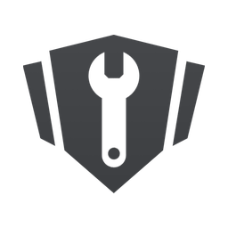
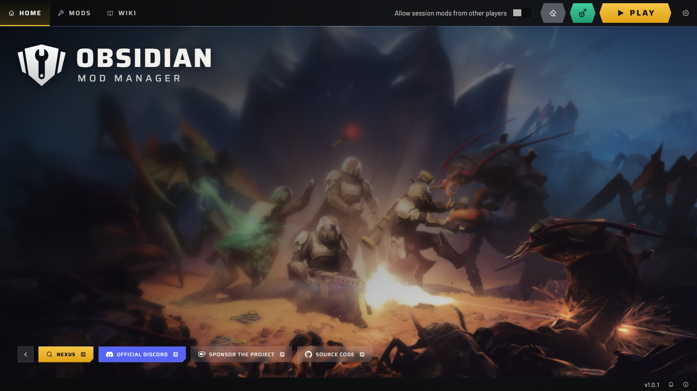
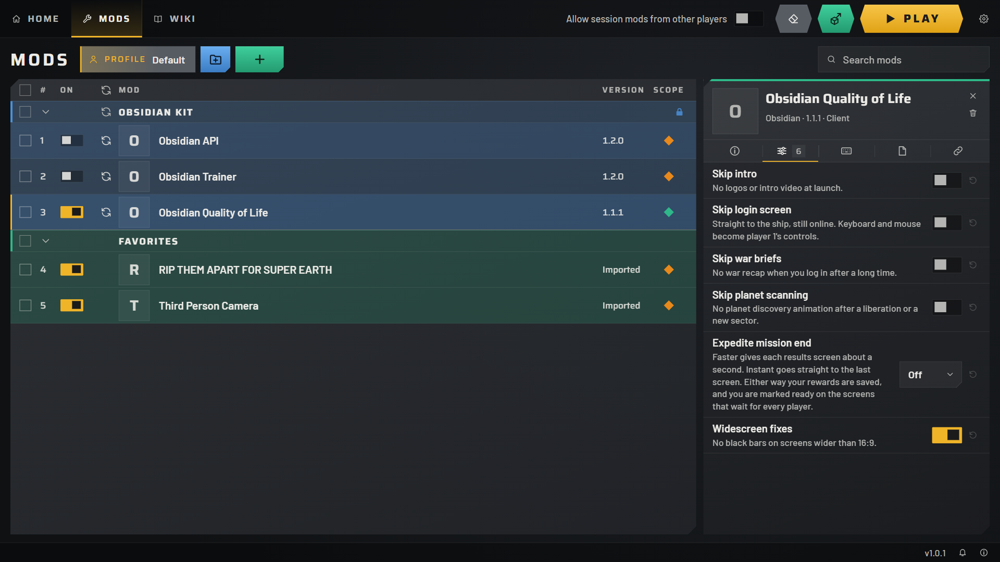
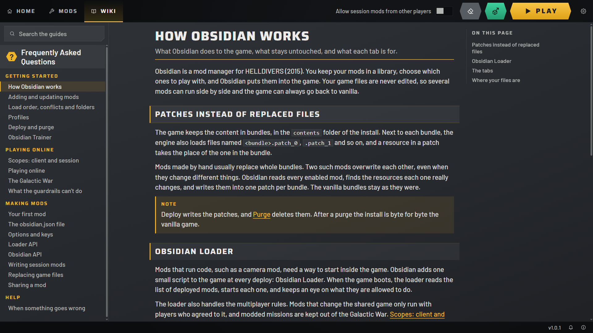

<p align="center">
  <picture>
    <source media="(prefers-color-scheme: dark)" srcset="app/src/assets/logo.png">
    
  </picture>
</p>

<h1 align="center">Obsidian</h1>

<p align="center">Mod manager and mod loader for HELLDIVERS (2015).</p>

<p align="center">
  
  
  
  <!-- the count of LANGUAGES in app/src/i18n.ts, listed under Supported Languages -->
  <a href="#-supported-languages"></a>
  <a href="https://github.com/Alomare/ObsidianModManager/releases/latest"></a>
</p>

<p align="center">
  <a href="https://dsc.gg/hd1modding"></a>
</p>

<p align="center">
  <a href="https://github.com/Alomare/ObsidianModManager/releases/latest"><b>Download</b></a> ·
  <a href="#features">Features</a> ·
  <a href="#how-it-works">How It Works</a> ·
  <a href="#how-to-use">How to Use</a> ·
  <a href="#making-mods">Making Mods</a> ·
  <a href="#command-line">Command Line</a> ·
  <a href="#questions-and-feedback">Questions and Feedback</a> ·
  <a href="#contributing">Contributing</a> ·
  <a href="#license">License</a>
</p>

<br>

<p align="center">
  
</p>

<br>

## Features

### 🧩 Mods

The mod library. Turn mods on and off, drag them into the load order, sort them into folders, and change options and keys for each mod. Conflicts show which mods change the same thing, and profiles keep separate sets of mods and settings. Mods that name a GitHub repository update from inside the app, and old mods that replace whole game files import like any other.



### 📖 Wiki

Guides inside the app, for players and for mod authors. They cover adding mods, load order, profiles, the multiplayer rules and troubleshooting, then go from a first mod to the loader API.



### 🎁 Obsidian Kit

Three mods come with Obsidian, in the Obsidian Kit folder. Obsidian Quality of Life starts on with only the widescreen fixes enabled, and the other two stay off until you turn them on. They're mods like any other: each has its own repository and updates from GitHub, and you can move or delete them. **Restore Obsidian Kit** in Settings puts everything back.

#### [Obsidian Quality of Life](https://github.com/Alomare/ObsidianQoL)

Skips the intro, the login screen, war briefs and planet scanning, removes the black bars on screens wider than 16:9, and can speed up or skip the results screens after a mission. Each fix is an option.

#### [Obsidian Trainer](https://github.com/Alomare/ObsidianTrainer)

An in-game window, opened with F6, for your character, weapons, stratagems, enemies, missions and game values. It works with the mouse or the keys, and you can move and resize it. It doesn't change XP or rank, doesn't unlock paid DLC and doesn't touch the Galactic War. It's a session mod, so it follows the same multiplayer rules as any other.

#### [Obsidian API](https://github.com/Alomare/ObsidianAPI)

A library other mods can build on. It turns on with the Trainer.

### 🌐 Supported Languages

English, Portuguese (Brazil) and Simplified Chinese, for the window, the messages and the Wiki. **Language** in Settings picks one, and until then Obsidian follows the language of Windows.

<br>

## How It Works

- Next to each content bundle, the game also loads patch files. Obsidian reads every enabled mod, finds what each one really changes, and writes one patch per bundle, so two mods only clash when they change the same resource.
- Game files are never edited. **Purge** deletes the patches, and the install is byte for byte vanilla again.
- Mods that run code start through Obsidian Loader, a small script added to the game at every deploy.
- Every mod has a scope. Client mods change only what you see, hear or press, and run in any lobby. Session mods can change the shared game, so they run alone, or in a lobby where every other player has agreed to them.
- Missions played with session content aren't reported to the Galactic War, and vanilla players don't find modded lobbies in matchmaking. These rules stop well-behaved mods from harming anyone by accident. They aren't anti-cheat.
- Saves are backed up before every deploy, including the ones in Steam Cloud.
- A Rust core does the work, and the window is Tauri 2 with React.

## How to Use

You need Windows 10 or 11, and HELLDIVERS installed through Steam.

1. Download Obsidian from [Releases](https://github.com/Alomare/ObsidianModManager/releases/latest) and run it. The installer isn't code-signed yet, so Windows may say it protected your PC: choose **More info**, then **Run anyway**.
2. Start Obsidian. It finds the game through Steam. If it can't, pick the game folder in Settings.
3. On the Mods tab, press the green **+**, or drop a `.zip` or a folder on the list. [Nexus Mods](https://www.nexusmods.com/games/helldivers) has mods to try.
4. Turn on the mods you want. When two change the same thing, the later one in the list wins.
5. Press **Play**. Obsidian deploys your changes, then starts the game through Steam.

To go back to vanilla, close the game and press **Purge**. Your library and profiles stay as they are. Do this before you uninstall Obsidian too, as the patches stay in the game folder until something removes them.

| Download | What it is |
|---|---|
| The `x64-setup.exe` file | The installer. It checks for new versions at startup and installs them when you say so. **Updates** in Settings changes that. |
| `ObsidianModManager-<version>-portable.zip` | The portable copy, with your library in a `data` folder beside the app. Unzip it anywhere and start `Obsidian.exe`. New versions are downloaded by hand. |

The window needs the Microsoft Edge WebView2 Runtime. The installer adds it when it's missing. For the portable copy, Windows 11 has it, nearly every Windows 10 PC has it too, and the rest can get [Microsoft's free download](https://developer.microsoft.com/microsoft-edge/webview2/).

## Making Mods

A mod is a folder with an `obsidian.json` file that describes it, plus the files it uses. A script mod needs one Lua file. Obsidian compiles the Lua when it deploys, so there's no compiler to install.

The Making Mods guides in the Wiki start with [Your First Mod](app/src/wiki/40-first-mod.md), then cover [the manifest](app/src/wiki/42-manifest.md), [options and keys](app/src/wiki/44-options-and-keys.md), the [Loader API](app/src/wiki/46-loader-api.md), [Obsidian API](app/src/wiki/47-obsidian-api.md), [session mods](app/src/wiki/48-session-mods.md), [replacing game files](app/src/wiki/50-resources.md) and [sharing a mod](app/src/wiki/52-sharing.md). A GitHub repository in the `source` field lets players update the mod from inside Obsidian.

## Command Line

`obsidian` does the same work from a terminal, on the same data. It isn't in the downloads: build it with `cargo build --release -p obsidian-core`, and run `tools\build-luajit.cmd` once for the LuaJIT 2.0 compiler that turns mod scripts into code the game can run. Run it with the game closed.

<details>
<summary>Commands</summary>

```
obsidian import <mod folder or .zip>   add a mod to the library (old whole-file mods work too)
obsidian list                          mods in load order, on or off
obsidian enable <id> / disable <id>    choose what to play with
obsidian order <id>...                 put these mods first; later mods win conflicts
obsidian conflicts                     show which mods change the same thing
obsidian deploy                        put the enabled mods into the game
obsidian purge                         take them out again
obsidian status                        game build, what is deployed
obsidian consent on|off                play session mods with other Obsidian users who allow them too
obsidian set <id> <option> <value>     change a mod option
obsidian remove <id>                   delete a mod from the library
obsidian key <id> <keybind> <key>      change a mod key
obsidian updates                       ask GitHub for new versions of the mods that name a repository
obsidian update [<id>...]              install new versions from GitHub
obsidian profile list|use|new <name>   switch between named sets of mods and settings
```

</details>

`--game <folder>` points at another install, when Steam can't find it.

## Questions and Feedback

Ask on the [Discord](https://dsc.gg/hd1modding) how to do something, or show what you made. Refer to the in-app Wiki before doing so.

To report a bug or suggest an idea, open an [issue](https://github.com/Alomare/ObsidianModManager/issues/new). For a bug, say what you did and what happened. **Copy report** in Settings, under Data, gives you the versions, the mods that were on and the end of the game log, without your Windows account name.

Obsidian is 100% free, no caveats. If you'd like to support it, buy me a [Ko-fi](https://ko-fi.com/alomare)!

## Contributing

Bug reports and help on the Discord count as much as code. The Wiki pages are Markdown files in [`app/src/wiki/`](app/src/wiki/), so a clearer sentence or a missing step is a good first pull request.

[CONTRIBUTING.md](CONTRIBUTING.md) has how to build and test Obsidian.

## License

Copyright (C) 2026 Alomare. Licensed under the [Apache License 2.0](LICENSE). The Obsidian Kit mods are under the MIT License, in their own repositories. The in-game menu uses Barlow and Saira, under the SIL Open Font License: see [loader/fonts](loader/fonts).

Only builds from this repository's GitHub releases are official Obsidian. The license gives no right to use the Obsidian name for other builds.
